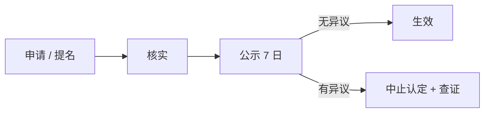
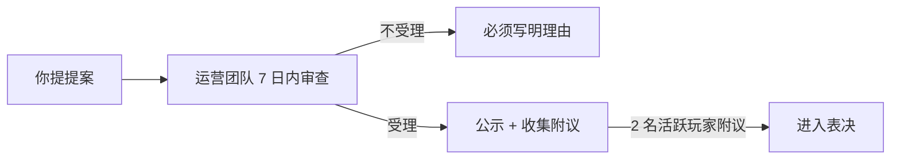

# 清屿服务器玩家身份与治理条例

> **版本：** v2.0.1 ｜ **更新日期：** 2026.10.30 ｜ **生效日期：** 2026.11.01 ｜ **面向对象：** 全体玩家

**先看这一句：** 人人平等，身份只有一个「贡献者」，规则由活跃玩家投票决定，运营团队只负责执行。

## 目录

- [第一章 三条底线](#第一章三条底线)
- [第二章 贡献者](#第二章贡献者)
- [第三章 提案与表决](#第三章提案与表决)
- [第四章 运营团队的边界](#第四章运营团队的边界)
- [第五章 回归玩家](#第五章回归玩家)
- [第六章 冲突与修订](#第六章冲突与修订)
- [附 常见疑问](#附常见疑问)
- [版本说明](#版本说明)

---

## 第一章　三条底线

### 1.1 没有等级

清屿**没有等级**：没有 Lv.1、Lv.2，没有贡献分，也没有排行榜。

*说人话：玩得久不会让你变强，只会让你更有名。*

### 1.2 身份只换展示

身份只带来三样东西：**称号、作品署名、展示位**。

换不来下面任何一项：

1. 飞行、创造模式、无敌这类改游戏机制的能力
2. 物品、游戏币、资源
3. 免除或减轻处罚
4. 绕过热力、性能、装置的限制
5. 对规则的解释权

*说人话：身份是荣誉，不是装备。称号再响，你的一票也只算一票。*

### 1.3 决定权和执行权分开

| | 谁 | 管什么 |
|---|---|---|
| **决定权** | 全体活跃玩家（成员大会） | 规则怎么定、重大事项怎么办 |
| **执行权** | 运营团队 + 值班管理员 | 运维、执行规则、处理纠纷、组织表决与公示 |

*说人话：定规矩的是大家，办事情的是少数人。**大家不能直接封人，少数人不能自己改规矩。***

---

## 第二章　贡献者

### 2.1 唯一的身份

清屿只有**一个身份：贡献者**。

建筑、红石与工程、公共设施、规则文档维护、带新人、组织活动、地图与教程 —— 这些**都算贡献，但不再各自立一个头衔**。它们只是通向同一个身份的入口。

*说人话：以前分成四类身份，光记条件就要背一页。现在只有一句话：**你为服务器做过事，你就是贡献者。***

贡献者**不分类别、不分等级、不叠加**。做过三件事和做过一件事，身份是同一个，区别只体现在你申请到的称号文字上。

### 2.2 怎么认定

满足下面**任意一条**即可：

| 路径 | 条件 |
|------|------|
| **贡献记录** | 至少 1 项可核查的公共贡献（有署名、有日志记录，或有其他玩家见证） |
| **社区提名** | 2 名活跃玩家联名提名 |

**"可核查"是什么意思？** 不是"我觉得我做了"，而是别人能看见：建筑在那儿、工程有记录、文档有提交记录、活动有公告、新人有印象。

*说人话：**自己申请走第一条，别人认可走第二条**。两条都留着，是因为有些人做过事但不爱说话。*

### 2.3 称号

- 默认称号为「贡献者」
- 可以自选文字（如"北岸建造者""红石维护"），须经运营团队核准
- 称号须符合《[玩家守则](清屿服务器玩家守则.md)》8.1.1 的语言规范，且不得让人误以为是官方职务（如"服主""管理员""官方"）
- 称号**不可转让、不可买卖、不可继承**

### 2.4 认定流程

公示要在官方 QQ 群说清楚**谁、什么称号、凭哪件事、什么时候生效**。**不能悄悄给。**

### 2.5 拿到什么

| 权益 | 说明 |
|------|------|
| **称号** | 群昵称后缀、游戏内称号 |
| **署名** | 公共作品、工程、文档上标注你的游戏 ID |
| **展示位** | 公告栏与官网的贡献者名单 |

**只有这三样。** 其余的（提案权、表决权、进服、发言）是白名单自带的，**跟身份无关** —— 新人和贡献者完全一样。

### 2.6 不会被撤销，除非……

贡献者身份**不因为不活跃而撤销**。人家贡献过了，后来去忙了，称号留着。

只有四种情况收回，且撤销必须**公示**：

| 情况 | 举例 |
|------|------|
| 用假材料拿到 | 谎报"我建了那座桥"，其实是别人建的 |
| 转让、买卖身份 | 把"贡献者"称号卖给别人 |
| 冒用身份对外发言 | 说"我是清屿官方，我们准备和 XX 联动" |
| 拿身份谋私利 | 用贡献者名义强占别人的地 |

撤销的处理幅度按《[管理员条例](清屿服务器管理员条例.md)》第十条、第十一条确定，参照[处罚细目表](处罚细目表.md)中性质最接近的条目。

### 2.7 违规一样罚

**有身份，违规照样罚，一分钟不少。**

*说人话：为什么要专门写这一条？因为"有功劳的人"最容易变成"有豁免权的人"。提前写死，免得事后吵。*

---

## 第三章　提案与表决

### 3.1 活跃玩家

**活跃玩家** = 投票开始那天往前数 30 天里，**登录过至少 1 次**的人。

**成员大会** = 全体活跃玩家凑成的表决体。它不是一群人开会，而是一次群投票的全体参与者 —— 没有主席，没有固定名单。

*说人话：登录一次就恢复资格，不用重新申请。*

### 3.2 提案

### 3.3 表决

在**官方 QQ 群投票**，持续 **7 日**。**不用在线**，在群里投就行。

| 事项 | 需要多少人参与 | 需要多少赞成 |
|------|--------------|------------|
| 一般事项 | ≥ 3 人 | 超过半数 |
| 重大事项 | ≥ 5 人 | 达到三分之二 |

**参与人数不够，投票直接作废** —— 防止"半夜叫三五个人就把事定了"。

**重大事项**共五类：

- 封禁制度的实质修改
- 《玩家守则》与《管理员条例》的修订
- 世界存档的公开与回档
- 服务器发展方向变更
- **贡献者认定标准与身份体系的调整**

*说人话：一般的事过半数就行；动根基的事要三分之二。*

### 3.4 复议

投票结果公示后 **3 日内**，运营团队可提请**一次**复议，须说明理由。复议门槛提高：一般事项 ≥ 5 人，重大事项 ≥ 8 人。

### 3.5 与七日阳光流程怎么接

《[七日阳光流程](清屿服务器七日阳光流程.md)》里的"表决"，就是本章的表决；公示期收集到的意见，在投票前汇总公示，作为投票依据。

唯一例外是**紧急修订**：涉及服务器安全、数据安全的紧急修复，可以先改后公示（见 [4.2](#42-紧急情况可以先动手)）。

---

## 第四章　运营团队的边界

**运营团队是谁：** 运营团队，以及他们带的值班管理员。平时和你们打交道的管理员，就是他们的具体落实者。

### 4.1 不能定规则

> **运营团队不享有立法权。规则的修订，以成员大会的表决结果为准。**

除紧急情况外，运营团队**不得中止、延后或不予执行**已经通过的表决结果。

*说人话：投票通过了就得办，不能"研究研究"然后没了。*

### 4.2 紧急情况可以先动手

涉及安全、数据、严重漏洞的事，可以先做，立刻生效。但两条约束都要做到：

1. **24 小时内公示** —— 说清楚做了什么、为什么做
2. **48 小时内提请追认** —— 让大会事后确认

**大会不追认的，措施自动失效**，运营团队还须按《[管理员条例](清屿服务器管理员条例.md)》第八条接受复核。

### 4.3 不能拿身份做人情

运营团队**不许**以"他有身份"为理由发放 [1.2](#12-身份只换展示) 所列的任何一项。已经发了的，必须**收回并公示**。

---

## 第五章　回归玩家

曾经玩过、后来离开、现在回来的玩家，凭**原 ID 的历史记录**、**早期自己建的建筑坐标**，或**两名以上玩家的证明**（三选一），即可恢复原有称号与贡献记录。

回归状态不需要公示，也不带任何额外权益。证明不了的，按新玩家流程入服。

*说人话：这不是为难人 —— 不验证的话，别人冒用你的 ID 就能拿走你的身份。*

---

## 第六章　冲突与修订

### 6.1 冲突时听谁的

| 争议类型 | 听谁的 |
|---------|--------|
| 身份怎么给、怎么撤 | 听这份文件 |
| 什么行为算违规 | 听《[玩家守则](清屿服务器玩家守则.md)》 |
| 罚多少 | 听《[管理员条例](清屿服务器管理员条例.md)》+ [处罚细目表](处罚细目表.md) |

### 6.2 怎么改这份文件

修订走《[七日阳光流程](清屿服务器七日阳光流程.md)》，按**重大事项**门槛表决。

### 6.3 生效与补办

本条例自 **2026.11.01** 起施行。生效之前运营团队口头给过的类似身份，**90 天内必须按正式流程补办公示**；逾期未补办的，相关权益中止，直到补办完成。

---

## 附　常见疑问

**Q：我不想要任何身份，可以吗？**

可以。贡献者是可选的，不要不影响你任何权利。

**Q：我只是个新人，这些跟我有关系吗？**

有。你有提案权、有表决权，跟你玩了多久无关；你也不欠任何人身份，不用讨好谁。

**Q：为什么把原来的四个身份合并成一个？**

四个身份的条件、流程、权益各写一遍，读者要记四套规则，实际差别却只有称号文字。合并后：**标准一条（做过事）、流程一套（核实 + 公示）、权益三项（称号、署名、展示位）。**

**Q：投票我投了，但总共只来了 2 个人，算数吗？**

不算。一般事项要 ≥ 3 人参与。

**Q：大会能不能直接决定封某个人？**

**不能。** 大会只管"规则怎么定"。处罚永远依据[处罚细目表](处罚细目表.md)，由运营团队执行。

---

## 版本说明

**v2.0.1（2026.10.30）** 相对 v2.0.0 的改动：

- 修正版本说明中的正文行数（约 450 / 180 行 → 488 / 286 行）
- 目录补上「版本说明」条目

**v2.0.0（2026.10.24）** 相对 v1.0.0 的改动：

- 四项身份（聚集地召集人 / 建造者 / 维护者 / 荣誉成员）**合并为单一身份「贡献者」**
- 删除"提案优先""专属频道"等身份特权 —— 与"人人平等"冲突
- 删除"90 天不活跃撤销身份"，改为**长期保留**
- 身份权益收敛为**称号、署名、展示位**三项
- 正文由 488 行压缩至 286 行，保留提案、表决、复议、执行层边界与回归玩家条款

---

## 相关文档

- **玩家行为规范：** 见[清屿服务器玩家守则](清屿服务器玩家守则.md)
- **管理员行为规范：** 见[清屿服务器管理员条例](清屿服务器管理员条例.md)
- **规则修订流程：** 见[清屿服务器七日阳光流程](清屿服务器七日阳光流程.md)
- **处罚幅度查询：** 见[处罚细目表](处罚细目表.md)
- **服务器地址与版本：** 见[服务器信息](../服务器信息.md)

---

© 清屿运营团队。
